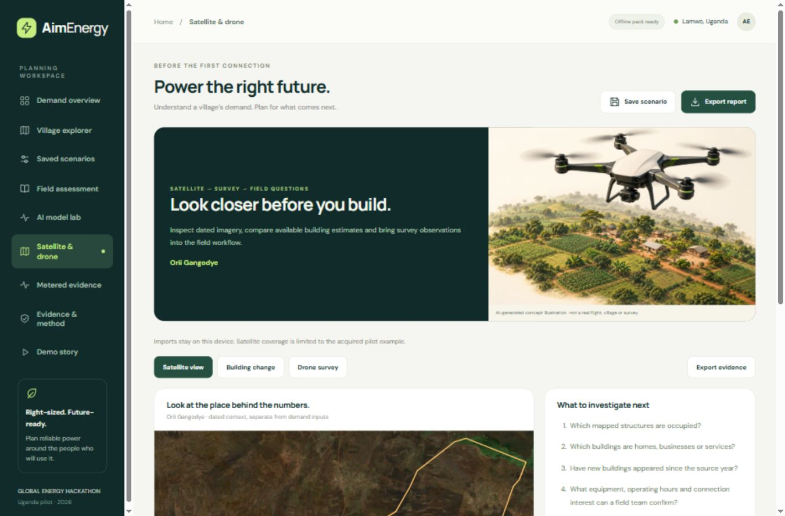

# AimEnergy

### Better decisions before the first connection.

AimEnergy is an AI-assisted planning prototype for estimating rural mini-grid demand before construction. It connects real village geography, dated satellite imagery, an inspectable household model, editable appliance scenarios and a field-assessment workflow so developers can see what supports an estimate and what to investigate next. Completed drone-survey outputs can be imported locally as additional context.

Built for **Global Energy Hackathon — Brief 03: Predict mini-grid demand before building**. The geographic pilot covers **Lamwo, Uganda**.


## What you can do

- **Explore 411 real villages** with population estimates, building counts, mapped facilities and geographic boundaries.
- **Build a demand scenario** from household connections, productive-use businesses and public services.
- **Compare 24 months** of editable uptake, appliance and business-growth assumptions, with low/base/high envelopes.
- **Inspect a trained household model**, its benchmark, feature inputs and evaluation limits before using its output as an assumption.
- **Take questions into the field:** inspect an evidence passport, answer sensitivity-ranked questions, preserve the baseline and compare a revision.
- **Prepare for offline assessment**, save scenarios locally and export reports with their assumptions and evidence methods.
- **Inspect satellite and drone evidence:** a dated pilot mosaic, local survey/image imports and a building-history CSV view; concept artwork stays distinct from measurements. See the [remote-evidence guide](aimenergy-app/docs/REMOTE_EVIDENCE.md).
- **Review real metered-current evidence** separately from household ML results and village planning scenarios.

## Run the prototype

Requires **Node.js 20 or newer**. No npm dependency installation, Python server, database or API key is needed to run the prepared browser demo.

From the repository root:

```sh
cd aimenergy-app
npm start
```

Open **http://127.0.0.1:4173/** for the landing page, then select **Open prototype**. The planner is also available at **http://127.0.0.1:4173/planner.html**.

On Windows, you can double-click `aimenergy-app/Start AimEnergy.cmd`. Keep the server terminal open while using the local app.

For a first demonstration, open **Demo story**, reset to the intended village defaults, compare a baseline with one hypothetical grain mill, then inspect **AI model lab**, **Satellite & drone**, **Field assessment** and **Metered evidence**.

## Satellite and drone evidence

Open **Satellite & drone** in the planner. If another village is selected, choose **Open the Orii Gangodye example** to see the acquired satellite layer.



| Feature | What is available |
|---|---|
| Real satellite imagery | A 2024 EOxCloudless / Sentinel-2 annual mosaic for Orii Gangodye, nominal 10 m resolution, with the village boundary overlaid |
| Source provenance | Mosaic year, extent, resolution, attribution, license and source hash; the annual mosaic is not a single dated acquisition or current survey |
| Drone-survey features | Local WGS84 GeoJSON import: Point, Polygon and MultiPolygon; up to 2,000 features, 50,000 vertices and 1 MB |
| Processed survey image | Local PNG/JPEG overlay with user-supplied WGS84 extent; up to 2 MB and 20 million pixels |
| Building-change view | Import a `year,building_count` CSV, identify its source, and inspect dated estimates with a year selector |
| Evidence handoff | Retain source and observation date, export evidence JSON, and continue to the selected village's field assessment |
| Drone illustration | AI-generated concept artwork on the landing page and in the workspace; explicitly separate from real survey evidence |

Automatic imagery coverage is currently **one pilot village**, not all 411 villages. Google Open Buildings Temporal village-count histories have **not** been acquired: local raster processing was blocked by insufficient disk space. The building-change view stays empty until dated observations are supplied; it does not invent a growth curve.

Imports stay in the visitor's browser. They do not upload automatically, retrain the model or change demand assumptions. The app does not control a drone, process raw flight photographs, detect roofs automatically or verify a survey's positional accuracy. Building counts do not establish occupied households, customers or electricity use.

The **field-v5** offline pack includes **33 static assets**, covering the new imagery, artwork and workspace. Prepare or refresh it while online, wait for Ready and reload. Imported records are stored separately from the app snapshot.

The satellite crop is a **noncommercial demonstration asset under CC BY-NC-SA 4.0**. It is attributed to [EOxCloudless](https://cloudless.eox.at) by [EOX IT Services GmbH](https://eox.at): **Contains modified Copernicus Sentinel data 2024**. Commercial deployment needs suitable permission or replacement imagery.

See the [satellite/drone guide](aimenergy-app/docs/REMOTE_EVIDENCE.md) for source details, supported formats, limits, storage and reproduction. The [artwork provenance](aimenergy-app/Data/metadata/drone-illustration.json) records the built-in image-generation tool, prompt and image hash.

## What the evidence supports

| Component | Current evidence | Scope |
|---|---|---|
| Geographic context | 411 villages, 39 candidate villages, 25 existing-site records across 24 villages | Settlement features and reference labels; not measured demand |
| Household ML | 64-tree random forest; 267 training / 89 calibration / 89 test households | Survey payment-derived electricity-use proxy |
| Held-out household result | MAE 44.14 versus 49.09 kWh/household/month for a median baseline | About 10.1% lower error on this sample; systematic underprediction remains |
| Household interval evaluation | 90% nominal; 77/89 = 86.5% observed coverage | Household survey scope; not village-total coverage |
| Geographic clustering | Four groups describing village context | Unsupervised descriptions, not electricity-demand labels |
| RAMP simulation | Seven categories × 30 seeded simulation days | Synthetic timing shapes scaled to scenario energy |
| Satellite context | Acquired 2024 mosaic for one pilot village, with boundary overlay | Landscape context; not roof-level enumeration, measured demand or current survey evidence |
| Drone/history imports | Browser-local survey features, processed images and dated counts | User-provided observations; no automatic validation or demand-model change |
| Tanzania metered research | 40,809 minute current records; four later-day comparisons at one site | Retrospective current-shape diagnostic, not measured kWh or unseen-site validation |

The survey contains **445 unique households**, despite 28,625 source rows. No Lamwo household sample was identified. Village totals and growth remain **uncalibrated planning scenarios**; low/high values are assumption envelopes, not confidence intervals. Independent unseen-site kWh validation is still an outstanding Brief 03 requirement.

Average-day peaks do not establish equipment sizes, motor starting requirements, reliability or investment returns. See the [model card](aimenergy-app/docs/MODEL_CARD.md), [methods](aimenergy-app/docs/METHODOLOGY.md) and [metered evidence](aimenergy-app/docs/METERED_EVIDENCE.md).

A newly acquired **CC0 DRC replication package** adds 175 area-month records, 13,479 client averages and 1,202 survey respondents. Its kWh figures represent prepaid electricity purchases used as a consumption proxy, rather than direct meter readings. All eight publisher file checksums were verified. See the [DRC suitability audit](aimenergy-app/docs/DRC_DATA_AUDIT.md) for missingness, differing area codes and the proposed separate benchmark; no new AimEnergy accuracy result has been established.

## Repository layout

```text
.
├── README.md                       Repository overview
├── AIMENERGY_ANALYSIS.md            Initial project analysis
└── aimenergy-app/                   Application root
    ├── READ.md                     Complete project guide
    ├── README.md                   Application introduction
    ├── package.json
    ├── server.mjs                  Local static server and optional HTTP API
    ├── vercel.json                 Static demo deployment configuration
    ├── dist/                       Browser app, landing page and public assets
    ├── Data/                       Local data workspace, audits and templates
    ├── Models/                     Model artifacts and training provenance
    ├── scripts/                    Preparation, training and packaging
    ├── tests/                      Runtime and data checks
    └── docs/                       Methods, pitch, pilot and verification
```

The [complete project guide](aimenergy-app/READ.md) covers equations, defaults, datasets, model evaluation, reproduction commands, offline operation, API contracts, deployment, troubleshooting and the documentation index.

## Publish a Vercel demo

Import this repository into Vercel and set **Root Directory** to **`aimenergy-app`**. Its `vercel.json` selects the prepared **`dist`** output and skips installation/build work that is unnecessary for the static demo.

The landing page, planner, browser-side ML, acquired satellite example, drone/history import workspace, assessments and exports run in this static deployment. No satellite account or additional API key is needed for the acquired example. The separate Node `/api/*` endpoints are not included. Saved records remain in each visitor's browser; localhost records do not automatically transfer to a deployed domain.

Follow the [Vercel deployment guide](aimenergy-app/docs/VERCEL_DEMO.md) for exact steps and post-deployment checks.

## Verification and reproduction

From `aimenergy-app`:

```sh
npm test
```

Recorded verification includes **42 JavaScript tests** covering planning invariants, village integration, model parity, API handling, field provenance, routing, offline snapshots and bounded remote-evidence imports. Seven additional Python checks cover private household-data audits and the metered diagnostic when their local data is available. Browser checks exercised GeoJSON/image/CSV imports, year selection, restoration, evidence export, desktop/mobile layouts and offline-pack preparation. Synthetic QA imports were removed afterward. See the [verification record](aimenergy-app/docs/VERIFICATION.md) for the exact scope and remaining limits.

Normal inference uses the prepared JSON model. Retraining needs the separately documented Python environment and local source data. RAMP uses a separate pinned environment. See [model artifacts](aimenergy-app/Models/README.md), the [data guide](aimenergy-app/Data/README.md) and the [complete guide](aimenergy-app/READ.md) before reproducing research outputs.

## Hackathon and pilot materials

| Document | Purpose |
|---|---|
| [Pitch](aimenergy-app/docs/PITCH.md) | Three-minute spoken story and demo notes |
| [Impact estimate](aimenergy-app/docs/IMPACT_ESTIMATE.md) | One-page evidence and impact scope |
| [Demo checklist](aimenergy-app/docs/DEMO_CHECKLIST.md) | Rehearsal, exports and submission checks |
| [Pilot protocol](aimenergy-app/docs/PILOT_PROTOCOL.md) | Proposed operator-data and untouched-site evaluation |
| [Operator data sharing](aimenergy-app/docs/OPERATOR_DATA_SHARING.md) | Aggregate sharing proposal and safeguards |
| [Deployment roadmap](aimenergy-app/docs/DEPLOYMENT_ROADMAP.md) | Conditional five-to-six-month path to an operator deployment |

The pilot plan depends on an operator agreement, suitable measured customer-kWh data, site-level validation, geographic transfer and operational readiness. Prototype results do not establish an operator partnership, achieved savings or a guaranteed production date.

## Data, attribution and appropriate use

Public runtime assets are under `aimenergy-app/dist/`. Raw household data, split membership, private operator records and credentials should not be placed there. The portable source package and private local-data package serve different purposes; consult their data-handling documentation before sharing.

The Tanzania research exhibit uses **CC BY-NC 3.0** data; commercial use/training clearance is not established. It is separate from the household model and planner inputs. Other data and dependencies retain their own terms. Read the [third-party notices](aimenergy-app/docs/THIRD_PARTY_NOTICES.md) for source attribution and the [data guide](aimenergy-app/Data/README.md) for publication boundaries.

The EOX satellite crop has its own **CC BY-NC-SA 4.0** terms. AI-generated drone artwork is labelled as illustration and is never used as measurement or training evidence. Keep `AimEnergy-ML-Local.zip` private; the portable demo package and private local-data archive have different sharing scopes.
