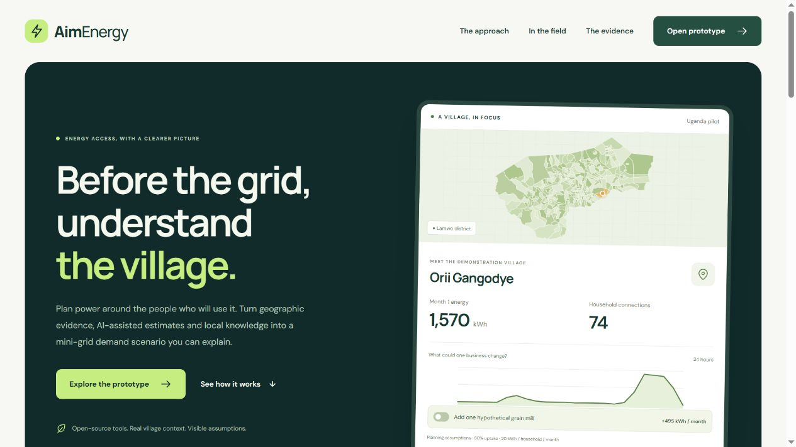

# AimEnergy

AimEnergy is a browser-based tool for planning rural mini-grids. It brings together village data, household models, demand scenarios and field assessments. A system feasibility workspace lets you explore how solar panels, batteries and a generator could serve an assumed load.

The geographic dataset covers **411 villages in Lamwo, Uganda**. This is a research prototype; village estimates and equipment scenarios still need field validation.



## Run locally

Install Node.js 20 or newer, then run:

```sh
cd aimenergy-app
npm start
```

Open [localhost:4173](http://127.0.0.1:4173/). The planner is at [planner.html](http://127.0.0.1:4173/planner.html). No dependency installation, database or API key is needed for the prepared app. Windows users can run **aimenergy-app/Start AimEnergy.cmd**.

## Features

- Browse village boundaries, population estimates, buildings, schools and clinics.
- Build household, business and public-service demand scenarios over 24 months.
- Review household model inputs, baseline comparisons and evaluation results.
- Record field answers, keep the original assumptions and compare revisions.
- Prepare the app for offline use and export assessments and reports.
- View a dated satellite example and import completed drone-survey outputs.
- Try a USSD simulator with a local review inbox and village-passport exports.
- Run hourly solar, battery and generator scenarios with editable costs, LCOE and NPV.

## System feasibility

The system workspace calculates 8,760 hourly steps, including unmet demand, battery flows, generator fuel and curtailed solar output. Equipment sizes and costs are user assumptions. Versions are saved in the browser; the complete scenario and a print-ready report can be downloaded.

A 2023 PVGIS resource is included for Orii Gangodye. Other locations need a matching PVGIS file. The model does not optimize equipment sizes or provide cable designs, protection studies or single-line diagrams. See [system methods](aimenergy-app/docs/SYSTEM_FEASIBILITY.md).

## Offline and community responses

Prepare the offline pack in Field assessment while connected, wait for Ready, then reload. The current pack contains 42 static assets. Records stay in browser storage until exported; there is no automatic synchronization between devices or domains.

Community USSD is a browser simulator, not a live telecom service. Responses remain labelled as simulations after review and do not automatically change a forecast. A live service would require mobile coverage, a provider and an online backend. See [community access](aimenergy-app/docs/USSD_OFFLINE.md) and [offline operation](aimenergy-app/docs/OFFLINE.md).

## Data and evaluation

| Component | Current evidence |
|---|---|
| Geography | 411 Lamwo records, 39 candidate villages and 25 existing-site records across 24 villages |
| Household model | 445 independent survey households; held-out MAE 44.14 versus 49.09 kWh/month for a median baseline |
| DRC benchmark | Three areas held out in turn; improved household uptake error, little change in household purchase error and worse business purchase error |
| Tanzania diagnostic | 40,809 minute current records from one site, used for a separate timing comparison |
| Solar example | 8,760 modeled PVGIS hourly samples for one village |

The Uganda household target is derived from payments at an assumed tariff. The DRC target uses prepaid kWh purchases. Neither is direct-meter consumption, and no Lamwo household sample was identified. Village low/base/high values are scenario envelopes, not calibrated confidence intervals. Dispatch and financial results do not establish field reliability, equipment suitability or investment returns.

Details: [model card](aimenergy-app/docs/MODEL_CARD.md), [DRC benchmark](aimenergy-app/docs/DRC_BENCHMARK.md) and [metered-data notes](aimenergy-app/docs/METERED_EVIDENCE.md).

## Deploy to Vercel

Import the repository and set **Root Directory** to **aimenergy-app**. The included configuration publishes **dist** as a static site. Browser calculations and cached examples work without a server API; the separate Node API is not part of that deployment. Follow the [deployment guide](aimenergy-app/docs/VERCEL_DEMO.md).

## Development

```sh
cd aimenergy-app
npm test
```

The JavaScript suite has 55 tests. Data preparation and retraining use separate Python environments and source files; they are not needed to run the prepared app. See the [project guide](aimenergy-app/READ.md) and [verification record](aimenergy-app/docs/VERIFICATION.md).

The application is in **aimenergy-app/**. Browser assets are in **dist/**, local data and audits in **Data/**, model artifacts in **Models/**, and supporting commands in **scripts/**.

## Documentation and sources

- [Project guide](aimenergy-app/READ.md)
- [Architecture](aimenergy-app/docs/ARCHITECTURE.md)
- [Demand calculations](aimenergy-app/docs/METHODOLOGY.md)
- [Field assessments](aimenergy-app/docs/FIELD_ASSESSMENT.md)
- [Satellite and drone evidence](aimenergy-app/docs/REMOTE_EVIDENCE.md)
- [Data workspace](aimenergy-app/Data/README.md)
- [Third-party notices](aimenergy-app/docs/THIRD_PARTY_NOTICES.md)

Datasets retain their own terms. The EOX satellite crop is CC BY-NC-SA 4.0 and the Tanzania exhibit uses CC BY-NC 3.0 data; commercial use needs review or replacement. The drone artwork is illustrative, not survey evidence; its source and generation details are recorded in the third-party notices. Keep raw household files, credentials and operator records outside public assets. The local-data ZIP is private and is not intended for publication.
