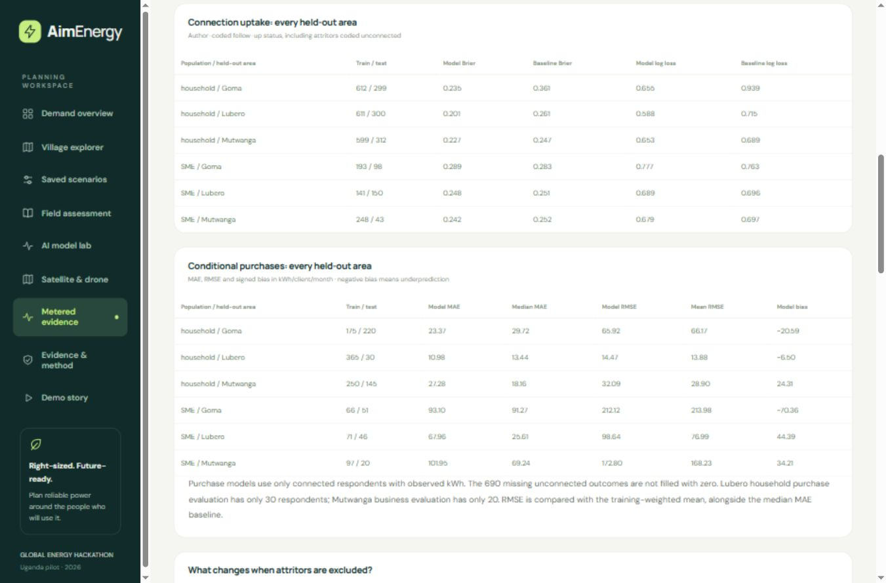

# DRC geographic uptake and purchase benchmark

This is a separate fixed-design research benchmark using the audited [Harvard Dataverse CC0 release](https://doi.org/10.7910/DVN/KPDREF). It does not retrain or validate the existing Uganda forest, set village assumptions or establish direct-meter consumption accuracy.



## Evaluation design

Three analysis areas are held out in turn: Goma, Lubero and Mutwanga. Each model trains on the other two. Households and SMEs have separate models and feature lists. The two tasks are author-coded connection status and average monthly prepaid kWh purchases conditional on connection. Missing unconnected purchases are not set to zero.

All forests use 64 trees, maximum depth 4, minimum leaf 12 and seed 20261031, with no tuning. Median imputation fits within each training fold; sampling weights govern forest fitting and evaluation. ID, area, enumerator, target-derived variables, follow-up responses and future conflict are excluded. Distance is omitted because availability of a planned alignment is uncertain. Complete features and settings are in [the protocol](../Data/metadata/drc-benchmark-protocol.json).

The protocol was written before fitting this configuration, after descriptive inspection of the supplied outcomes. It is a retrospective experiment, not preregistration. Primary uptake follows the authors' connection coding, including attritors coded unconnected. A fixed sensitivity analysis excludes attritors from training and scoring. Purchase sensitivity is unchanged because connected respondents with observed purchases are not attritors.

## Results

Pooled out-of-fold, sampling-weighted primary results:

| Population / task | Evaluation respondents | Forest | Baseline | Interpretation |
|---|---:|---:|---:|---|
| Household uptake, Brier | 911 | 0.2214 | 0.2885, training prevalence | Lower error in pooled evaluation |
| SME uptake, Brier | 291 | 0.2610 | 0.2621, training prevalence | Small pooled difference |
| Household purchases, MAE | 395 | 23.87 | 23.88, training median | Almost unchanged |
| SME purchases, MAE | 117 | 84.61 | 61.66, training median | Forest performs worse |
| Household purchases, RMSE | 395 | 52.10 | 51.52, training mean | Forest performs worse |
| SME purchases, RMSE | 117 | 168.95 | 164.72, training mean | Forest performs worse |

Purchase errors are kWh per connected client per month. Lower MAE, RMSE, Brier and log loss are better; signed bias is prediction minus observation. Both median and mean purchase baselines are fitted only on training areas. The mean is an appropriate additional comparator for squared error.

The public [results JSON](../dist/data/drc-benchmark.json) includes every geographic fold, support counts and effective weight sample sizes, both purchase baselines, signed bias, log loss, attrition sensitivities, and both pooled and equal-area summaries. Pooled RMSE is calculated from pooled squared errors, not averaged fold RMSE. Equal-area household purchase MAE is 20.54 for the forest versus 20.44 for the median, so the tiny pooled MAE advantage does not survive that alternate aggregation. These differences do not establish statistical significance.

## What the result means for the prototype

The current model shows useful household uptake signal in these areas, with little evidence of improved conditional purchase prediction. SME purchases have large heterogeneous errors and limited samples. Retain productive-use scenarios and field questions rather than automatically replacing assumptions with these estimates. No favorable-area selection or retuning was performed after seeing these results.

Only three areas under one operator are available. Lubero household purchase testing has 30 observations; Mutwanga SME purchase testing has 20. There is no independent-operator or Uganda test. The target consists of purchases over different connection-to-follow-up windows, with exact dates unavailable, rather than direct meter readings or a fixed first-year consumption horizon. No village-total confidence intervals, growth forecast or equipment-size result is established.

For a stronger next study, agree a fixed target horizon with an operator, acquire direct-meter kWh and preconstruction features, and preserve additional sites untouched during model development. The current results do not close Brief 03's direct-meter site-validation gap.

## Reproduce and inspect

From `aimenergy-app`, in the existing pandas/NumPy/scikit-learn research environment:

```sh
python scripts/build_drc_benchmark.py
python -m unittest discover -s tests -p test_drc_benchmark.py
npm test
```

Use `--source /path/to/dataversefiles` for another source location. The script verifies publisher checksums, records its protocol before fitting, and exports aggregate-only results. The JSON includes survey, script and protocol hashes and exact dependency versions. No individual predictions or respondent IDs are exported; source microdata remains outside `dist`.

Open **Metered evidence** in the prototype for the DRC tables, attrition sensitivity and downloadable protocol, followed by the existing Tanzania current diagnostic. Offline release `field-v6` includes both the new rendering module and result JSON.
