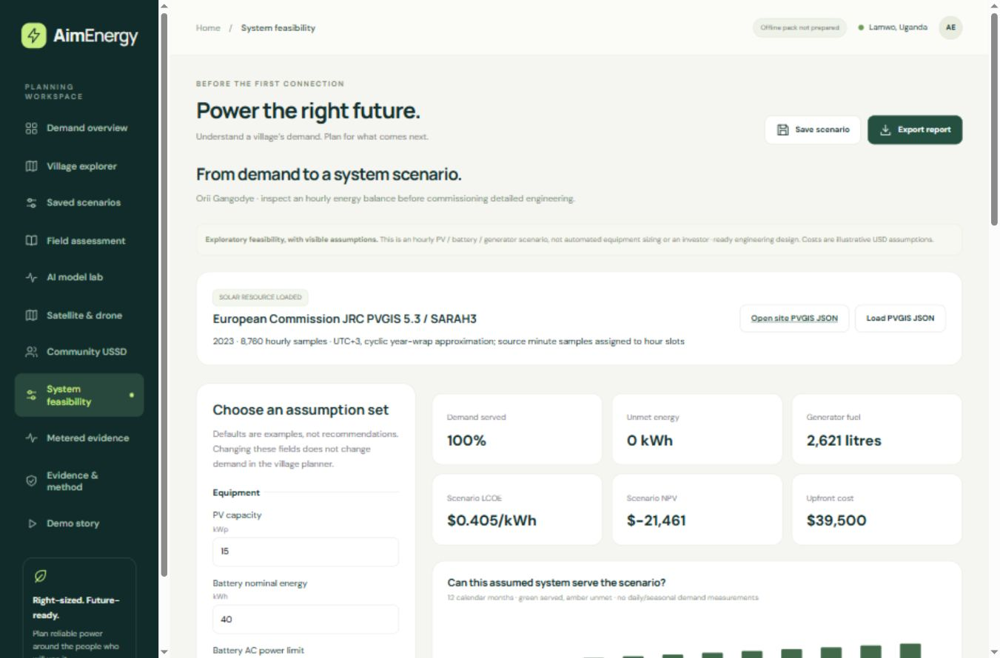

# System feasibility: demand to an hourly supply scenario

AimEnergy's System feasibility workspace extends the demand planner with an **exploratory PV / battery / diesel-generator simulation**. It is an assumption-driven comparison tool, not optimized equipment sizing, certified engineering or an investment recommendation.

## Available now

- 8,760 one-hour dispatch steps, with PV, battery charge/discharge, generator output, unmet demand and curtailment.
- Editable equipment capacities, AC-side power limits, efficiency and fixed fuel intensity.
- Monthly served/unmet-demand chart and an operating/energy ledger.
- Illustrative constant-real-USD capex, operating costs, collected revenue, discounted LCOE and NPV.
- One selected-year full battery replacement, when it falls inside the analysis horizon.
- Latest ten local versions, each retaining equipment/cost assumptions, the demand snapshot and solar resource.
- Full JSON export including every hourly result, plus a standalone print-ready HTML report. Use browser Print / Save as PDF to create a PDF; no native PDF file is generated automatically.

Open `planner.html#system`. Changes in this workspace do not alter the village demand planner. Viewing a saved version freezes its demand/resource inputs; editing creates a working copy. Versions remain on this browser, not in a cloud account, and do not synchronize across computers or domains.

## Actual solar source and coverage

The acquired pilot is **Orii Gangodye, site 5502954**, at latitude 3.487226, longitude 32.969193. Its PVGIS 5.3 series uses **2023 SARAH3 solar data and ERA5 meteorology**, 1 kWp c-Si, free-standing, 10° south-facing, with 14% system losses already included. Modeled annual yield is about **1,593.67 kWh/kWp**. This is not measured generation or satellite imagery.

The cached pilot resource loads automatically when that village is selected. Other locations need a matching source file. **Open site PVGIS JSON** constructs an official request for the selected coordinates; download that response and use **Load PVGIS JSON**. The browser does not silently assign the pilot's resource to other sites. The static demo has no automatic live-fetch backend. PVGIS 5.3 disallows direct AJAX browser calls; see the [official API documentation](https://joint-research-centre.ec.europa.eu/photovoltaic-geographical-information-system-pvgis/using-pvgis-5/api-non-interactive-service_en).

Imports are limited to 2 MB. They require 8,760 chronological, gap-free hours from one non-leap year, finite nonnegative PV power and positive reference kWp, and coordinates within 0.02° of the selected site. The current conversion assumes Uganda's UTC+3; use outside that time zone requires an adapted importer. Source samples are assigned to hourly slots, shifted three hours, and cyclically wrapped at the year boundary. This is a disclosed annual alignment approximation, not a forecast or a typical meteorological year.

Reproduce with `python scripts/acquire_solar_resource.py`. The script uses the retained source copy when available, otherwise requests the official endpoint. Source inputs, URL, row count and SHA-256 are retained in `Data/metadata/solar-resource-audit.json`. Raw JSON remains Git-ignored in `Data/raw/solar`; the compact public series is `dist/data/solar-resource.json`.

## Demand and dispatch assumptions

The first twelve months of the current demand scenario are mapped to a non-leap calendar. Each month's energy total is preserved while its normalized 24-hour profile repeats daily; there are no measured weekday, seasonal or operating-day patterns. Historical 2023 weather is combined with these hypothetical demand assumptions, not represented as an observed 2023 village load.

PV serves load first. Surplus charges the battery subject to headroom and AC power limits; remaining surplus is curtailed. Deficits use battery discharge, then the generator up to its rating, then become unmet demand. The generator never charges the battery.

Battery SOC is bounded to 20–95% of nominal capacity and starts at 20%. One-way efficiencies are the square root of round-trip efficiency. Charging adds AC charge times efficiency to storage; discharging removes delivered AC energy divided by efficiency. Initial/final stored-energy values include the minimum SOC floor. Fuel is generated kWh times an editable fixed litres/kWh assumption, excluding idling and minimum-loading effects.

The ledger conserves hourly energy and storage losses. Battery charge/discharge are intermediate flows, not extra generation. Average-hour results do not establish surge capacity, voltage, protection, reliability or equipment ratings.

## Financial interpretation

All default prices and costs are **illustrative assumptions, not supplier quotes**. Initial capex is PV, battery and generator capacities times their unit costs, plus other capex. Annual expense is simulated fuel cost plus assumed O&M as a percentage of initial capex. Revenue is served energy times assumed collected revenue per kWh.

LCOE equals discounted lifecycle costs divided by discounted served energy; zero served energy returns unavailable. NPV includes initial investment at year zero and end-year net cashflows. Financial years repeat the first simulated year's weather, demand and dispatch, resetting initial battery SOC, with one replacement in the selected year if inside the horizon. No degradation or demand growth is projected across the financial horizon. There are no taxes, debt, inflation, subsidies, salvage or replacement-price forecasts.

For context on discounted-cost/energy equations, see [SAM's LCOE documentation](https://samrepo.nlr.gov/help/mtf_lcoe.html). AimEnergy's simpler implementation is not a SAM model or an independently validated commercial financial assessment. A positive NPV does not establish bankability, and serving 100% of this assumed load does not establish actual field reliability.

## Scope and next steps

IRR, automatic sizing optimization, grid import/export, battery ageing, detailed generator fuel curves, PV strings/layout, LV/MV networks, cable sizing, protection and single-line diagrams are not implemented. No claim of international engineering-standard compliance is made. A qualified engineering workflow and suitable validation remain separate requirements.

Release 3.6.0 / **field-v8** caches 42 assets, including the pilot resource and system modules. Imported resources remain in memory unless captured in a saved version or exported. No provider credentials or recurring AI inference call is needed for the prepared example.
