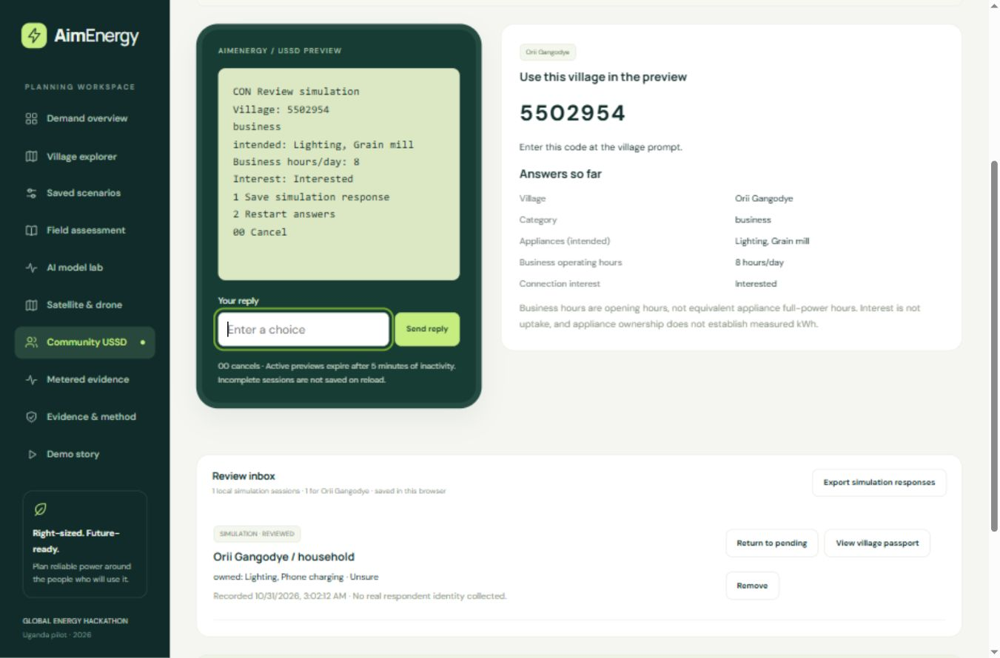

# Community USSD preview and offline access

AimEnergy demonstrates a developer web dashboard, a prepared offline field kit, and a browser simulation of basic-phone community participation. **No live service code, telecom connection, SMS or automatic cloud synchronization is implemented.**

## Try it

Open `planner.html#community` or choose **Community USSD**. The landing page also links to the preview.

1. Start a preview and agree to local simulation storage, or cancel.
2. Enter the displayed village code. Numeric codes must match a loaded village; unassigned manual locations are excluded.
3. Choose household/business and currently owned appliances or intended future purchases.
4. Select appliance numbers separated by commas. Businesses also report opening hours, from 0 to 24.
5. Record connection interest: interested, not interested or unsure.
6. Review the on-phone recap and confirm saving. `00` cancels; incomplete responses never enter the inbox.
7. Mark the local simulation reviewed, then open its village passport. Review is reversible and does not verify answers.

The passport shows counts and expandable answers in a separate simulation section. Its JSON export includes village-scoped community evidence. The standalone export contains all completed simulator responses. Nothing automatically changes connections, appliance loads, demand assumptions, training or source geography.

## Evidence and storage

Records have fixed `channel: ussd_simulator` and `method: demonstration`, consent to local simulation, recording time, village code, category, appliance basis/choices, optional business hours and interest. Review adds a timestamp while retaining the evidence type. Restore validation rejects live/verified labels, invalid values and unknown villages; arbitrary properties are stripped.

Business opening hours are not appliance full-power hours. Interest is not a connection commitment. Owned and intended appliances remain distinct. No kWh is inferred, and session counts are not unique people or representative uptake rates. No name, phone number or free-text personal information is collected.

Completed records use browser storage key `aimenergy.community.v1`, with a 200-response maximum. Active sessions are memory-only and end on reload. The prototype's five-minute inactivity limit is not a telecom network's guaranteed session duration. Invalid replies retain the prompt and show an error. Storage failure produces a memory-only warning and export reminder.

Remove supports **Undo last removal** until the next removal or reload. Review can return to pending. Restored records are revalidated and duplicate session IDs skipped. Export before clearing site data or changing devices. Localhost records do not automatically appear on a deployed domain. There is no response import, shared inbox or automatic synchronization.

## Offline operation

Prepare or refresh the pack in Field assessment while connected, wait for Ready and reload. **field-v7 includes 38 required static assets**, including the three community files. Completed responses live separately in browser storage and are not uploaded when preparing the snapshot.

The simulator works without the app server after preparation. Actual USSD requires mobile coverage, although the phone need not have a smartphone data connection; a live gateway requires a reachable backend. See [provider setup](https://help.africastalking.com/en/articles/9915125-how-do-i-go-live-with-ussd) and [callback hosting](https://help.africastalking.com/en/articles/2206161-how-do-i-configure-my-callback-url).

## Live pilot path

Confirm country/operator coverage, code availability, costs, menu lengths, languages and timeouts. Add a validated gateway integration, bounded server sessions, durable storage, rate controls, retry handling, retention/deletion procedures and monitoring. Separately establish consent and handling of phone numbers if the gateway transmits them. None of these live-provider requirements is exercised by the simulator.

The Vercel static demo needs no telecom key. Live callbacks require a separately deployed backend and provider-assigned service code. Keep credentials out of browser assets. A future real-data channel needs a separate evidence type and validation path; never relabel simulated records.

Measure completion/dropout, cost per usable response, independently verified observations and operator adoption. A demonstration session does not establish representative demand, willingness to pay or realized uptake.
